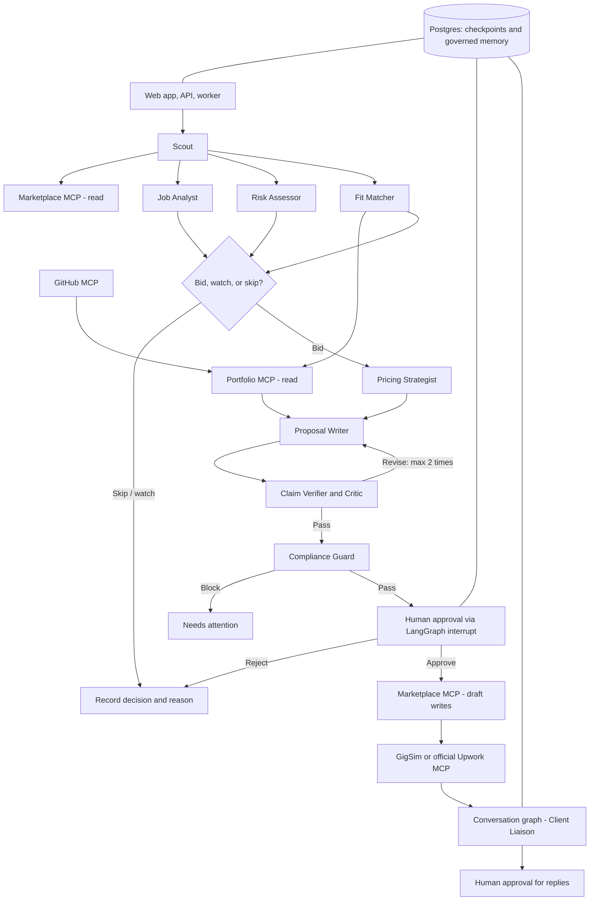

# GigBid — Multi-Agent Freelancer Copilot

**Technical project specification**  
**Focus:** LangGraph multi-agent systems · Advanced RAG · Model Context Protocol (MCP) · Full-stack web application

## 1. Overview

GigBid is a deployable web application where a team of LangGraph agents discovers freelance jobs, evaluates whether they are worth bidding on, drafts proposals grounded in real portfolio evidence, and manages client conversations. A human must approve every proposal and message before it leaves the system.

GigBid supports a marketplace simulator (**GigSim**) for safe development and evaluation and Upwork's official MCP server for real use. The goal is a useful freelancer-facing product, not merely a demonstration of agent orchestration.

### Technical objectives

1. Build and consume MCP servers, including a remote, OAuth-protected third-party server, through a clean adapter that works with simulated and live marketplaces.
2. Implement and measure advanced RAG, including hybrid search, reranking, outcome-aware ranking, and claim verification.
3. Design a LangGraph multi-agent system with parallel branches, bounded critique loops, human approval, persistence, and long-term memory.
4. Build a responsive full-stack UI that streams agent progress and supports approval, editing, and rejection.
5. Operate the system with scheduling, CI evaluation, tracing, guardrails, budgets, and deployment.

### Technology stack

| Layer | Technology |
| --- | --- |
| Language and agent framework | Python 3.11+, LangGraph, `langchain-mcp-adapters` |
| MCP servers | Official MCP Python SDK |
| API | FastAPI |
| Web frontend | Next.js or React with TypeScript |
| Relational database and checkpointing | PostgreSQL |
| Queue and background jobs | Redis with Celery, Arq, or Dramatiq |
| Retrieval | A vector store, dense embeddings, and optional BM25 / graph index |
| Observability | LangSmith, Langfuse, or Arize Phoenix |
| Local model serving | Ollama, vLLM, or llama.cpp |
| Packaging | Docker Compose |

## 2. The Product

### Problem

Freelancers spend hours scanning job feeds, waste paid Connects on unlikely opportunities, send generic proposals that clients ignore, and encounter scams asking for free work or off-platform payment. GigBid automates discovery, assessment, and drafting while leaving consequential decisions to the freelancer.

### User journey

1. The freelancer signs in, connects a marketplace, uploads a portfolio (CV, case studies, GitHub repositories, and historical proposals with outcomes), and configures rates, filters, and a weekly Connects budget.
2. GigBid periodically pulls jobs from saved searches, deduplicates them, identifies risks, scores portfolio fit, recommends **bid**, **watch**, or **skip**, and suggests a price.
3. For a suitable job, GigBid drafts a cover letter and screening answers, linking every substantive claim to portfolio evidence. A Critic reviews the proposal, followed by a Compliance Guard.
4. The freelancer reviews, edits, and approves the draft. The marketplace receives only the approved draft; live Upwork workflows still require the platform's own final confirmation.
5. When a client responds, GigBid proposes a reply and possible interview slots, updates the pipeline, and uses outcomes to improve future decisions under explicit memory rules.

### Development and evaluation resources

| Component | Contents | Purpose |
| --- | --- | --- |
| GigSim marketplace | REST API and seed data containing jobs, client histories, Connects, proposals, messages, rate limits, and simulated errors | Safe and repeatable marketplace integration |
| Simulated clients | Hidden preferences (must-have skills, budget ceilings, dislike of generic openings) and an LLM deciding whether to reply, interview, or hire | Measures actual simulated outcomes, not just model-generated quality scores |
| Three freelancer personas | AI/ML engineer, full-stack developer, and data analyst; each includes a CV, 15–25 case studies, repository files, client reviews, and roughly 150 previous proposals labeled won, replied, or ignored | Realistic, mixed-format RAG corpora |
| Policy pack | Marketplace rules covering off-platform contact/payment, fabricated experience, guarantees, and appropriate automation | Reference rules for the Compliance Guard |
| Job stream | Approximately 1,500 historical jobs plus new jobs including duplicates, scams, and prompt injections | Exercises pricing, scouting, risk analysis, and prompt-injection defense |
| Development evaluation set | Approximately 200 jobs per persona, labeled for bid/skip, scam risk, supporting evidence, and fair pricing | Repeatable experiments and model selection |
| Held-out evaluation set | Unseen jobs and clients | Detects overfitting and checks generalization |

### Live marketplace mode

Upwork's official MCP endpoint is `https://mcp.upwork.com/mcp`, using OAuth 2.1. Its capabilities cover job search, proposal drafting and submission, invitations, offers, contracts, and messaging. Use the same internal marketplace port for GigSim and Upwork. All live write actions must be user-approved drafts, followed by any confirmation required by Upwork. Live mode is not measured by forced submissions or automated outreach.

### Handling platform-policy changes

GigSim may introduce a new bidding rule or Connects cost. Keep marketplace rules, prompts, thresholds, and fee assumptions in configuration rather than hard-coded into agent logic. Track what changed, the files updated, the resulting behavior, and the engineering effort needed to adapt.

## 3. Agents and Responsibilities

| Agent | Responsibility | MCP access |
| --- | --- | --- |
| **Scout** | Run scheduled saved searches, deduplicate jobs, and queue work | Marketplace (read) |
| **Job Analyst** | Extract `JobSpec`: deliverables, skills, budget, timeline, screening questions, and implicit needs | None |
| **Risk Assessor** | Assess client quality; flag scams, free work, off-platform requests, and injected instructions | Marketplace (read) |
| **Fit Matcher** | Map requirements to portfolio evidence; generate a fit score with reasons | Portfolio (read) |
| **Pricing Strategist** | Suggest a bid based on market statistics, client spend, user rate floor, and expected Connects value | Marketplace (read) |
| **Proposal Writer** | Draft evidence-backed cover letters and screening answers with citations | Portfolio (read) |
| **Critic** | Check factual grounding, personalization, and length; request at most two revisions | Portfolio (read) |
| **Compliance Guard** | Enforce policy and remove forbidden contact information, guarantees, and invented experience | None |
| **Client Liaison** | Interpret client replies, draft responses, offer interview slots, and update the pipeline | Marketplace (read; write after approval), Workspace |

Roles can be merged or split if an engineering comparison supports the change, but their responsibilities must still be covered.

### Core system requirements

- **R1 — Single marketplace port:** All marketplace calls pass through one interface with GigSim and Upwork adapters selected by configuration.
- **R2 — MCP tool layer:** Build Portfolio (read-only), Marketplace (GigSim reads and writes), and Workspace (calendar and email drafts) MCP servers; integrate official Upwork MCP plus a separate third-party server such as GitHub.
- **R3 — Explicit LangGraph:** Implement the agent workflow as a hand-written `StateGraph`, running Job Analyst, Risk Assessor, and Fit Matcher in parallel.
- **R4 — Human approvals:** Use LangGraph interrupts in the web UI before sending proposals or messages or spending Connects.
- **R5 — Evidence-grounded claims:** No proposal may state experience unsupported by a portfolio source. Measure the unsupported-claim rate.
- **R6 — Evaluated RAG:** Choose the deployed retrieval design based on measured results.
- **R7 — Governed memory:** Promote edits and outcomes into long-term memory only under explicit rules.
- **R8 — Observability and budgets:** Trace runs and record p95 latency and cost per analyzed job and drafted proposal.
- **R9 — Safety:** Defend against injected job/message instructions, mask PII in logs, respect rate limits, and prohibit scraping.
- **R10 — Deployment:** `docker compose up` launches the local stack; a public web deployment supports a designated demo account.

### Reference architecture

The following Mermaid diagram expresses the key flow depicted in the source architecture figure, including parallel job analysis, bounded critique, human approval, and the marketplace adapter:



## 4. Models: Open and Local First

GigBid must be usable end to end without a paid-model requirement. An optional paid-model profile can be offered when its measured improvement justifies additional expense.

- Define `open` and optional `paid` profiles in `agent/config.yaml`. The `open` profile uses open-weight models locally through Ollama, vLLM, or llama.cpp, or through a hosted open-model provider.
- The deployed application must function with the `open` profile. Hosted open-model providers can be useful on deployment hosts without a GPU; verify current service terms and limits.
- Embeddings and reranking use open models in both profiles, ideally running on a CPU.
- Select models **per node**. Frequent routing, risk, intent, and compliance checks can use small models; the Writer and Critic can use stronger models. Never hard-code model selections in node implementations.
- Compare at least two open-model configurations on the development set. Record quality, latency, cost in USD for APIs, and hardware throughput (including tokens/second) for local models.
- Free GPU environments such as Colab or Kaggle may be useful for evaluation.

The following is a **source-document shortlist dated October 2026**, not a verified current leaderboard:

| Role | Laptop / CPU / up to 8 GB VRAM | 16–24 GB GPU / Colab / Kaggle | Hosted open-model provider |
| --- | --- | --- | --- |
| Router, classifiers, risk checks | Quantized Qwen3 4B or 8B | gpt-oss-20b | gpt-oss-20b |
| Writer, Critic, Client Liaison | Not recommended at this hardware tier | Qwen 3.6 27B (4-bit), gpt-oss-20b | gpt-oss-120b, Kimi K2.6, DeepSeek V4, GLM 5.1 |
| Embeddings | nomic-embed-text, BGE-M3 | Qwen3-Embedding 0.6B–8B | Same models, self-hosted |
| Reranker | bge-reranker-v2-m3 | Qwen3-Reranker | Same models, self-hosted |

## 5. MCP: The Tool Layer

Agents should use MCP tools instead of directly accessing GigSim, Upwork, databases, or filesystem capabilities that belong behind the tool layer. Every tool needs a schema, ownership, documented permissions, and automated tests. The Portfolio server should be usable by external MCP hosts such as Claude Desktop or Cursor.

### A1. Portfolio MCP server — `mcp_servers/portfolio`

Implement this read-only server using the official MCP Python SDK.

- Tools: `search_evidence(requirement, k, filters)` returning evidence objects with type, source, date, and outcome; `get_case_study(id)`; `list_skills()`.
- Resources: templates including `portfolio://case/{id}` and `portfolio://proposal/{id}` for full documents.
- Prompts: useful reusable templates, such as “Answer a screening question from my portfolio.”

### A2. Marketplace MCP server — `mcp_servers/marketplace`

Wrap GigSim with read and write tools.

- **Read:** search jobs, get job, get client history, get Connects balance, list messages.
- **Write:** `create_proposal_draft`, `submit_proposal`, `send_message`.
- Define strict Pydantic input constraints and output schemas. Use appropriate MCP hints: `readOnlyHint`, `destructiveHint`, `idempotentHint`.
- Add an **idempotency key to every write** to prevent duplicated submissions or Connects charges.
- Expose `dry_run` to preview payload and cost in the approval UI.
- Protect the HTTP endpoint with bearer authentication, enforce per-user rate limits, and maintain an append-only audit log containing user, tool, arguments, result, and trace ID.

### A3. Workspace MCP server — `mcp_servers/workspace`

Provide free-calendar-slot lookup, tentative interview holds, and email-draft creation. Back these tools with official Google Calendar and Gmail APIs or a local mock. Agents must only see the MCP interface.

### A4. Live Upwork adapter

- Use `MultiServerMCPClient` over Streamable HTTP and complete the OAuth flow; encrypt per-user tokens.
- Map Upwork tools onto the internal marketplace port without changing graph behavior.
- Choose conservative, justified read schedules. Never approximate scraping by aggressive polling.
- Send proposals and messages as drafts **only after** approval in GigBid, followed by separate Upwork confirmation when required.
- Do not use browser automation, session cookies, or scraping.

### A5. Other third-party MCP servers

Use the official Upwork MCP server and at least one independently maintained MCP server, such as GitHub for repository ingestion. Give each an explicit trust rationale in `docs/TOOLS.md`.

### A6. Client reliability

Limit tools by agent role; use timeouts and bounded exponential-backoff retries. If the marketplace server becomes unavailable, the UI should explain the degraded state, queue recoverable work, and resume when the dependency returns.

### A7. Tool tests and design experiment

- Test tools through an in-memory MCP client, inspect interfaces with MCP Inspector, and snapshot tool schemas so accidental signature changes fail CI.
- **Research question A:** Does tool granularity affect behavior? Compare fine-grained tools, coarse-grained tools, and a tuned set with improved descriptions on **40 tasks** with known correct calls.
- Measure tool-selection accuracy, argument accuracy, and token usage per task.
- Maintain `docs/TOOLS.md` with one row per tool covering name, server, read/write permission, annotations, and authentication.
- Capture Inspector examples and a trace of an agent drafting one grounded proposal for a GigSim job.

## 6. Advanced RAG: Evidence, Not Vibes

Proposal claims must be anchored in true, relevant evidence. The corpus intentionally combines code with prose, repeats projects in multiple formats, implies skills rather than naming them, and includes historical proposal outcomes.

### B1. Ingestion

Load PDF CVs, Markdown case studies, repository READMEs and source files (via GitHub MCP), reviews, and past proposals. Every chunk should carry metadata: persona, type, project, skills, date, client industry, and (for proposals) outcome. Reindex incrementally when the portfolio changes.

### B2. Retrieval variants

Implement baseline **V0** plus at least four variants covering query improvement, retrieval improvement, and an agentic method (V8 or V9). Configure variants as independent components, for example `rag/variants/v2_hybrid.py`, so one command can repeat experiments.

| ID | Variant | Category | What it tests |
| --- | --- | --- | --- |
| V0 | Naive dense retrieval with fixed-size chunks and top-k cosine search over the full job post | Baseline | Reference point for improvements |
| V1 | Requirement decomposition: retrieve for each extracted requirement and merge results | Query | Jobs with several distinct requirements |
| V2 | BM25 + dense retrieval with reciprocal rank fusion | Retrieval | Exact technologies such as Celery, dbt, or Pinecone |
| V3 | Cross-encoder reranking | Retrieval | Precision at a small k |
| V4 | Outcome-aware ranking boosted by proposals that won or got replies | Ranking | Learning from successful historical outcomes |
| V5 | Multiple vectors for a project's summary, README, and code, returned as one project | Indexing | Repositories whose README conceals relevant implementation work |
| V6 | Contextual retrieval with an explanatory context line prepended to each chunk | Indexing | Fragments that lose meaning in isolation |
| V7 | HyDE: retrieval guided by a hypothetical ideal proposal | Query | Vague job descriptions |
| V8 | Corrective / self-RAG graph: assess retrieved evidence, re-query when weak, decline unsupported claims | Agentic | Jobs where evidence is insufficient or a skip is appropriate |
| V9 | Skill graph linking skills, projects, clients, industries, and outcomes | Agentic | Complex relations such as experience with a skill in a given industry |

### B3. Claim verification

After drafting, split a proposal into independently checkable claims. Label each **supported**, **partly supported**, or **unsupported** against retrieved evidence. Remove or rewrite unsupported claims before the Critic sees the draft. Measure unsupported-claim rates before and after verification.

### B4. Evaluation

Evaluate every persona using the development set:

- **Retrieval:** evidence Recall@5, MRR, and nDCG@10 against reference evidence.
- **Decisions:** bid/skip F1, scam-detection precision and recall, and fraction of prices within fair bands.
- **Proposal quality:** unsupported claims per proposal; a calibrated LLM quality judge; blinded human pairwise comparisons on anonymized proposals.
- **Outcome:** GigSim reply rate and hire rate on a fixed job set.
- **Speed and cost:** p50/p95 latency, token use, and USD per analyzed job and per proposal.

Calibrate the LLM judge by manually labeling **30 items** and measuring Cohen's kappa against the judge.

### B5. Comparison table template

| Variant | Evidence Recall@5 | nDCG@10 | Unsupported claims per proposal | Judge score | GigSim reply rate | p95 latency (s) | Cost per proposal (USD) |
| --- | --- | --- | --- | --- | --- | --- | --- |
| V0 | | | | | | | |
| Selected pipeline | | | | | | | |

### B6. RAG research study

**Research question B:** Form a hypothesis before experiments—for example, that requirement decomposition plus hybrid search improves Recall@5 by 15 percentage points over V0 for jobs with four or more requirements. Ablate the selected pipeline one component at a time and segment results by persona and job type. Explain cases where better retrieval does not lead to higher reply rates.

Maintain `docs/DATA_CARD.md`, variant implementations, a reproducible comparison script, judge calibration results, and a short deployment-choice rationale.

## 7. LangGraph Multi-Agent Orchestration

Implement two durable graphs that pause for user approval, recover after failures, learn from outcomes under explicit memory rules, and explain decisions.

### C1. Two graphs

**Bid graph (one thread per job):** Scout supplies a job; Job Analyst, Risk Assessor, and Fit Matcher run in parallel using `Send`. A decision node chooses skip, watch, or bid. A bid continues through Pricing Strategist, Proposal Writer, claim verification, Critic, Compliance Guard, and a human-approval interrupt before any marketplace write.

**Conversation graph (one thread per conversation):** Client Liaison reads new client messages, classifies intent (question, negotiation, interview, scam signal), drafts a reply or offers interview times, and interrupts for approval.

### C2. State, tracing, and long-term memory

Use a typed `TypedDict` or Pydantic state with dedicated job, analysis, evidence, decision, price, draft, critique, approval, and outcome fields. Define reducers for keys written by concurrent branches.

Keep three distinct layers:

1. **State:** information needed for the present job or client conversation.
2. **Execution trace:** names, arguments, results, observations, and timestamps for audit/debugging.
3. **Long-term memory:** only explicitly promoted knowledge written to a LangGraph store.

Maintain separate memory stores for **style preferences** inferred from user edits (e.g., removing a formulaic opener) and **outcomes** by job category (won, replied, ignored). Never write raw tool output into long-term memory without a promotion policy.

### C3. Structured agent handoffs

Exchange Pydantic objects for all decision-bearing handoffs, including `JobSpec`, `RiskReport`, `FitReport`, `BidDecision`, `PriceQuote`, `ProposalDraft`, `Critique`, and `ComplianceVerdict`.

### C4. Bounded loops and budgets

The Critic can request at most **two** rewrites. The Compliance Guard may block a draft with a visible reason. Enforce per-thread step and token budgets; on exhaustion, set a visible **needs attention** state.

### C5. Human-in-the-loop operations

Call `interrupt()` before proposal submission, message sending, or Connects spending. Approval data includes the draft, evidence for every claim, risk summary, price rationale, and `dry_run` preview. The user may **approve**, **edit**, or **reject** with a reason. Store diffs for potential style-memory promotion; re-check edited drafts for compliance. Users may enable automatic skipping of low-fit opportunities, but **never automatic sending**.

### C6. Durability and recovery

Use a PostgreSQL checkpointer. Test a crash while a proposal awaits approval, restart the API, approve in the UI, and verify that it submits **exactly once**. Support history-based replay from graph checkpoints.

### C7. Failure handling

Apply per-node timeouts, bounded retries, fallback models for inexpensive nodes, dead-letter states for unrecoverable work, and graceful handling of GigSim rate limits and HTTP 5xx errors.

### C8. Multi-agent architecture experiment

**Research question C:** Is the hand-built multi-agent graph worthwhile? Run **50 development jobs** through three implementations:

1. A single ReAct agent with all tools.
2. A prebuilt supervisor using `langgraph-supervisor`.
3. The custom LangGraph architecture.

Compare bid/skip accuracy, unsupported claims, detected compliance violations, GigSim reply rate, tokens, and latency. Report circumstances in which a simpler agent is better. Save architecture diagrams generated from code, traces for skipped scams, approved proposals, Critic loops, crash/restart cases, and the comparison table.

## 8. Web Interface

The UI is the system's human control surface. Use **Next.js or React (Vite) with TypeScript**, and **FastAPI** for the backend. Do not substitute Streamlit or Gradio for the application frontend.

### Required screens

| Screen | Functionality |
| --- | --- |
| Sign-in and onboarding | Multi-user authentication; persona or personal profile; GigSim/Upwork account connections via OAuth; portfolio upload; rates, filters, weekly Connects budget |
| Job inbox | Jobs ranked by fit; risk flags; recommended actions, pricing, Connects costs; filtering, skipping, detail navigation |
| Job detail | `JobSpec`, risk report, requirement-to-evidence matrix, suggested pricing, bid/skip rationale |
| Proposal studio | Evidence hover for each claim; inline Critic and Compliance notes; paragraph regeneration; approve, edit, reject; `dry_run` payload and cost |
| Pipeline board | Kanban stages: drafted, submitted, viewed, replied, interview, hired, lost; event-driven updates |
| Messages | Conversation threads; draft replies; suggested interview times; approval before sending |
| Agent run viewer | Live node-by-node LangGraph progress, linked to full traces |
| Analytics | Reply and hire rates, Connects spent vs. outcomes, per-proposal latency and cost, reasons for rejection |
| Settings | Autonomy configuration, budgets, saved searches, accounts, view/delete memory |

### Frontend and API engineering

- Stream LangGraph run progress using Server-Sent Events or WebSockets instead of blocking requests.
- Resume interrupted graph threads from approval controls. Pending approvals must survive browser refreshes.
- Generate the TypeScript API client from FastAPI OpenAPI; do not hand-edit generated code.
- Support desktop and phone layouts, keyboard access, and clear loading, empty, and error states such as **marketplace unavailable**.
- Add at least **five Playwright end-to-end tests** covering onboarding, approval, rejection with explanation, draft editing, and degraded-mode UI.
- Record a workflow demonstration covering inbox → approved proposal → client reply, and retain the Playwright test report.

## 9. Production Engineering

### E1. Scheduling and workers

Run scouting and long agent execution through Redis-backed Celery, Arq, or Dramatiq workers, rather than synchronous web handlers. Give saved searches schedules and document conservative live polling in `docs/RUNBOOK.md`. Ensure worker restarts cannot double-analyze jobs or double-submit proposals.

### E2. Evaluation in CI

`make eval` computes retrieval and decision metrics and a fixed GigSim outcome run, writing `evals/results/*.json`. GitHub Actions runs unit tests, MCP contract checks, Playwright tests, and a **30-job smoke evaluation** on pull requests. Set thresholds to catch regressions in unsupported claims and bid/skip F1.

### E3. Observability

Use LangSmith, self-hosted Langfuse, or Arize Phoenix. Propagate one trace ID from UI to API, graph nodes, every MCP server, and audit logs. Record node-level token counts and costs.

### E4. Guardrails

- Treat job descriptions and client messages as **untrusted data**. Delimit their content and never obey embedded instructions. Measure prompt-injection success before and after defenses using planted examples.
- Redact emails, phone numbers, and payment information from logs and traces.
- Encrypt OAuth tokens, never write them to logs, and enforce per-user/tenant data isolation.

### E5. Latency and cost budgets

Declare latency targets (especially p95) and monetary budgets per analyzed job and per drafted proposal. Measure results against a held-out evaluation run. Document at least one effective optimization, such as cheap routing models, evidence caching, prompt trimming, or early skip decisions.

### E6. Packaging and deployment

`docker compose up` should start the web application, API, background worker, MCP servers, GigSim, PostgreSQL, Redis, vector database, and Ollama service for the open model profile. Supply `.env.example` with variable names only; never commit actual `.env` secrets. Deploy a public web instance with a preloaded demonstration persona/account.

## 10. Repository Layout

Use this as the project layout. Extra files may be added without breaking referenced paths or CI conventions.

```text
gigbid/
├── README.md                    # Product pitch, demo GIF, architecture, results, live link, traces
├── Makefile                     # make dev | test | eval | seed | demo | lint
├── pyproject.toml               # Pinned Python dependencies (uv or Poetry)
├── .env.example                 # Placeholder environment variables, never secrets
├── apps/
│   ├── web/                     # Next.js or React + TypeScript
│   │   ├── src/app/             # inbox, jobs/[id], studio/[id], pipeline,
│   │   │                        # messages, runs/[id], analytics, settings
│   │   ├── src/components/      # EvidenceHover, ApprovalPanel, RunTimeline, ...
│   │   ├── src/lib/api/         # Generated client for FastAPI OpenAPI
│   │   └── tests/e2e/           # Playwright tests
│   └── api/                     # FastAPI
│       ├── main.py
│       ├── routers/             # auth, jobs, proposals, approvals, messages, runs, analytics
│       ├── streaming.py         # SSE or WebSocket bridge to LangGraph
│       ├── auth/                # Users, sessions, encrypted OAuth token store
│       └── schemas/             # Request and response schemas
├── agent/
│   ├── state.py                 # Typed state and reducers
│   ├── handoffs.py              # Pydantic agent handoff objects
│   ├── graphs/
│   │   ├── bid_graph.py
│   │   └── conversation_graph.py
│   ├── nodes/                   # scout, analyst, risk, matcher, pricing,
│   │                            # writer, verifier, critic, compliance, liaison
│   ├── prompts/                 # One versioned Markdown prompt per node
│   ├── memory/                  # store.py, promotion_rules.py
│   ├── mcp_client.py            # MultiServerMCPClient, per-agent tool allowlists
│   ├── marketplace_port.py      # Single interface with adapters
│   └── config.yaml              # Model profiles, budgets, thresholds
├── rag/
│   ├── ingest/                  # Loaders, parsers, chunkers, GitHub ingestion
│   ├── index/                   # Vector, BM25, graph (if V9)
│   ├── variants/                # v0_naive.py ... v9_skill_graph.py
│   ├── retriever.py             # Configurable retriever factory
│   └── verify.py                # Claim splitting and evidence grounding
├── mcp_servers/
│   ├── portfolio/               # server.py, tools.py, resources.py, prompts.py, tests/
│   ├── marketplace/
│   │   ├── server.py
│   │   ├── adapters/             # gigsim.py, upwork_live.py
│   │   └── tests/
│   └── workspace/               # Calendar and email draft tools/tests
├── worker/                      # Scheduled scouting and long jobs
├── gigsim/                      # Marketplace simulator; do not change its source
├── data/
│   ├── personas/                # Sample portfolio corpora
│   ├── policy_pack/             # Marketplace rules
│   └── processed/               # Generated files, git-ignored
├── evals/
│   ├── datasets/                # Development datasets only
│   ├── runners/                 # rag_eval.py, decision_eval.py, gigsim_outcomes.py,
│   │                            # judge_calibration.py, ablation.py
│   └── results/                 # Reproducible JSON/CSV metrics
├── tests/
│   ├── unit/
│   ├── integration/             # LangGraph + GigSim
│   └── contract/                # MCP tool-schema snapshots
├── infra/
│   ├── docker/                  # Dockerfiles for services
│   └── docker-compose.yml
├── .github/workflows/
│   ├── ci.yml                    # Lint, unit, contract, Playwright
│   └── eval.yml                  # Smoke evaluation and regression thresholds
└── docs/
    ├── ARCHITECTURE.md          # Diagram and agent tradeoffs
    ├── adr/                     # Engineering decision records
    ├── DATA_CARD.md
    ├── TOOLS.md
    ├── RUNBOOK.md
    ├── EXTENSION.md
    ├── AI_USAGE.md
    └── images/
```

### Repository safeguards

Automated checks should verify that no secrets are committed, the `gigsim/` simulator remains unchanged, prompts reside under `agent/prompts/`, and metric claims in the README and design review link to `evals/results/`.

## 11. Product Portfolio and Optional Distinguishing Extension

The public README should explain the project to a potential client or hiring manager quickly, linking a live app, short demo, architecture diagram, and one complete trace.

### Signature extension — implement one

- **X1 — Agency mode:** Support multiple freelancers and route each opportunity to the strongest-fit member while drafting in their preferred voice.
- **X2 — Proposal experiments:** A/B test two proposal strategies in GigSim and evaluate the statistical significance of reply-rate differences.
- **X3 — Portfolio builder:** Turn GitHub repositories into code-verified case studies and index them in the Portfolio MCP server.
- **X4 — Client research:** Generate client briefs from marketplace history and public business data accessed through legitimate APIs/search tools, never scraping.
- **X5 — Negotiation coach:** Build a negotiation subgraph with walk-away rules and evaluate achieved versus offered rates in GigSim.
- **X6 — Personal live-mode pilot:** Use a real Upwork account for two weeks, collecting funnel metrics (jobs seen, bids, views, replies), with explicit approval of all sends.

Document the selected extension and its measurements in `docs/EXTENSION.md`.

### Project artifacts

- A README with a **30-second demo GIF**, architecture diagram, RAG comparison table, multi-agent comparison table, and links to **three public traces**.
- A publicly accessible application with a demonstration login containing a sample persona.
- A **three-minute demo video** showing a job from inbox to approved proposal, a scam identified, an injected instruction ignored, and a client reply handled.
- A distributable Portfolio MCP server, with installation via PyPI, `uvx`, or Docker and its own README.
- A **1,200–1,800-word technical article** explaining a surprising measured result (not just a tutorial).
- Two concise résumé bullet points using numbers that can be reproduced from `evals/results/`.

**Data confidentiality:** The sample personas and GigSim data are synthetic. Never publish held-out evaluation data, real client information, or access tokens.

## 12. Engineering Design Review

Maintain a concise engineering design review with evidence links to results files, traces, or commits. A possible structure is:

1. **Problem and constraints:** Freelancer workflow, non-automatable actions, latency and cost budgets.
2. **Architecture:** Both graphs, marketplace interface, MCP boundaries, data stores, and reasoning behind agent separation.
3. **MCP experiment:** Tool-granularity hypothesis, setup, results, and conclusions.
4. **RAG experiment:** Variants, claim verifier, ablations, persona/job-type breakdown, and selected pipeline.
5. **Agent experiment:** Comparison of the ReAct baseline, supervisor, and custom graph.
6. **Policy-change response:** What changed, what required modification, and the effort to adapt.
7. **Signature extension:** Functionality, experiment design, and measured outcomes.
8. **Failure analysis:** At least ten failed development jobs grouped into categories such as missed evidence, wrong skip, mispricing, unsupported claim, generic opening, compliance miss, injection, and tool error. Record attempted fixes and whether they worked.
9. **Safety and platform respect:** Forbidden actions, enforcement, and residual risks.
10. **Held-out evaluation:** Generalization, latency, cost, and limitations relative to declared budgets.

Negative results are valuable if they are measured and explained. For example, a reranker may improve evidence quality without improving client reply rates.

## 13. Safety and Platform Terms

Upwork's guidance restricts scraping, spammy proposals, and unapproved bot behavior. Design GigBid around platform-approved interfaces and explicit human authority.

- Use only official Upwork MCP tools or authorized APIs for live access. Never scrape, automate browsers, or reuse session cookies.
- Never send a proposal or message without human approval in GigBid and any additional marketplace confirmation.
- Never fabricate experience. Proposal claims must remain supported even if unsupported wording appears to improve response rates.
- Prefer GigSim when unsure whether an automated action is permitted by a live platform.
- Record use of AI coding assistants in `docs/AI_USAGE.md`: which tools helped with which files and at least one detected mistake that was corrected.
- Keep evaluation figures truthful, do not train on held-out data, and preserve reproducible experiment provenance.

### Practical failure and recovery checks

1. Stop the marketplace MCP server and verify the UI enters a clear degraded mode while queueing recoverable work.
2. Approve a proposal, stop the worker before transmission, restart it, and verify exactly-once submission.
3. Remove evidence behind a proposal claim and regenerate; check that unsupported claims disappear.
4. Open the trace of an incorrectly skipped job and identify the responsible node.
5. Test embedded prompt-injection instructions and document both successful defenses and remaining weaknesses.
6. Inspect what style memory learned from recent edits, justify promotions, and delete an entry from the UI.
7. Switch configuration from GigSim to Upwork and verify that the graph stays unchanged.
8. Compare disagreements between human ratings and the calibrated LLM quality judge.
9. Identify where the single-agent baseline outperforms the larger graph.
10. Introduce a marketplace-policy change and inspect the code/config diff required to accommodate it.

## 14. Reference Stack and Reading

Prefer primary documentation and pin dependency versions in the repository. Research papers and product capabilities should be checked against their current versions when implementation begins.

| Area | Primary reference |
| --- | --- |
| Upwork official MCP server | https://www.upwork.com/ai/mcp |
| Upwork automation terms | Upwork Help: bots and automation |
| MCP specification | https://modelcontextprotocol.io |
| MCP Python SDK | https://github.com/modelcontextprotocol/python-sdk |
| MCP to LangGraph adapter | `langchain-mcp-adapters` |
| LangGraph: state, Send, interrupts, checkpoints, memory, streaming | Official LangGraph documentation |
| Supervisor baseline | `langgraph-supervisor` |
| Self-RAG and Corrective RAG | Asai et al. (2023); Yan et al. (2024) |
| HyDE | Gao et al. (2022) |
| GraphRAG | Edge et al. (2024) |
| Contextual retrieval | Anthropic engineering article |
| RAG evaluation | RAGAS documentation |
| Web technologies | FastAPI, Next.js, Playwright official documentation |
| Open-source tracing | Langfuse; Arize Phoenix |

---

*Adapted from the supplied GigBid specification PDF.*
