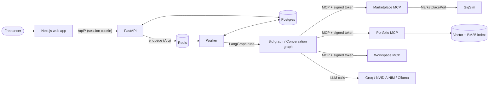

# Architecture

GigBid helps a freelancer find jobs, decide whether to bid, draft evidence-backed proposals and
answer clients. A person approves every external action. This page covers the moving parts and
why the agents are split the way they are. The graph diagrams are generated from code (`make
diagram`) into [images/bid_graph.mmd](images/bid_graph.mmd) and
[images/conversation_graph.mmd](images/conversation_graph.mmd).

## System

| Part | Code | Responsibility |
| --- | --- | --- |
| Web app | `apps/web` | Inbox, job detail, proposal studio, run timeline, pipeline, messages, settings and memory. Streams progress over SSE and shows approval panels. |
| API | `apps/api` | Auth, ownership checks, read models and approval decisions. It never runs a graph itself; it records decisions and enqueues work. |
| Worker | `worker/main.py` | Runs and resumes graphs, scouts saved searches, checks inboxes, records outcomes and sweeps orphaned runs. |
| Graphs | `agent/graphs` | Hand-written LangGraph `StateGraph`s with a Postgres checkpointer (runs) and a Postgres store (long-term memory). |
| MCP servers | `mcp_servers/*` | The only way agents touch the outside world. See [TOOLS.md](TOOLS.md). |
| Marketplace port | `agent/marketplace_port.py` | One interface for marketplace reads and writes. The GigSim adapter implements it; a live Upwork adapter would plug in through `marketplace.adapter`. |
| Retrieval | `rag/` | Per-persona chunked index; the deployed hybrid + outcome pipeline is chosen in [RAG_STUDY.md](RAG_STUDY.md). |

## Data stores

| Store | What it holds |
| --- | --- |
| Postgres, app tables | Users (argon2 hashes, settings), saved searches, `bid_threads` and `conversations` with summary fields, stage and the `pending_resume` outbox. |
| Postgres, LangGraph | Checkpoints for every graph step (resume after a crash or an approval), plus the memory store: namespaces `style`, `style_candidates` and `outcomes` per user. |
| Redis | The Arq job queue (deduplicated by job id) and per-thread run locks, so one thread never runs twice at once. |
| Files | The portfolio index in `data/processed/index/<persona>` (vectors, chunks, manifest; rebuilt incrementally), workspace calendar and drafts as per-account JSON, and the MCP audit log. |

## Bid graph

`scout` → (`analyst` ∥ `risk` ∥ `matcher`) → `decide` → `pricing` → `writer` → `verifier` →
`critic` (back to `writer` at most `critic.max_revisions` times) → `compliance` →
`request_approval` (interrupt) → `submit`.

- **Parallel analysis.** The three analysis branches are independent reads, so running them
  together cuts wall time. Each has its own timeout inside the node (`_contained`), because
  LangGraph's `error_handler` does not fire when sibling tasks share a superstep.
- **Deterministic floors around the models.** `decide` applies config thresholds to the
  structured reports. `risk` adds rule-based flags (off-platform payment, zero-spend unverified
  clients) that a model cannot talk its way out of. `pricing` is arithmetic over comparable jobs
  and fees, not model output.
- **Grounding.** The writer must cite evidence ids. The verifier labels every claim against the
  retrieved evidence, and an id the evidence does not contain is unsupported by construction.
  Unsupported sentences are removed before the critic sees the draft. Citations are stripped
  from the client-facing text at submit time.
- **Approval.** `request_approval` previews the proposal with a dry-run marketplace call, then
  interrupts. Approve, edit (with text) or reject (with a reason) resumes the run. Edits feed
  the memory rules.

## Conversation graph

`read` → `classify` (intent; hard scam rules override the model) → `find_slots` (interview
requests only) → `liaison` (draft reply) → `check` (compliance) → `request_approval`
(interrupt) → `send` (message plus a calendar hold).

The liaison never sees the price floor except during a negotiation, and proposed times are
appended in a canonical format rather than written by the model.

## Durability and failure handling

- **Checkpoints.** Every superstep is checkpointed. A worker crash resumes from the last
  checkpoint, and side effects use idempotency keys (`_key`), so a replayed submit is a no-op at
  GigSim.
- **Outbox for approvals.** The API writes the decision to `pending_resume` before enqueueing.
  If the queue message is lost, the worker's orphan sweep finds the thread and resumes it.
  Duplicate deliveries see "already applied".
- **Budgets.** Every node checks steps and tokens against `budgets` in the config, counted from
  the start of the current run. Model calls have per-node timeouts and retry with backoff.
- **Degraded mode.** When the Marketplace MCP or GigSim is unreachable, runs end as "needs
  attention" with the reason. The UI shows a banner, and the worker replays the run later (at
  most `worker.max_replays` times).
- **Models.** Each node has a primary model and a fallback (`agent/config.yaml` profiles).
  Several Groq keys rotate on rate limits.

## Security boundaries

- **Untrusted input.** Job posts and client messages are wrapped as untrusted data in every
  prompt and are never treated as instructions. The planted injections in GigSim exercise this
  path.
- **Least privilege per agent.** Agents get tools by role (`ALLOWLIST` in
  `agent/mcp_client.py`). The writer cannot submit, and only the post-approval `submit` and
  `liaison_send` steps can write.
- **Per-user tokens.** Each MCP call carries an HMAC-signed, expiring bearer token for one
  account, and the servers scope every read and write to that account.
- **No automatic sends.** Nothing reaches the marketplace without a human decision recorded
  through the API.

## Why separate agents

Each agent owns one decision with its own typed handoff (`agent/handoffs.py`), prompt version,
model choice and tools. This brings three benefits:

- A cheaper model can serve the extraction steps while a stronger one writes.
- A failure is attributable to one step in the run timeline.
- Rules can wrap a single step without touching the others.

The cost is more model calls per job (about 8–10, roughly 9k–25k tokens) and more latency than
a single agent. Whether that trade pays off is research question C, comparing a single ReAct
agent, a prebuilt supervisor and this graph. That comparison is not run yet.
